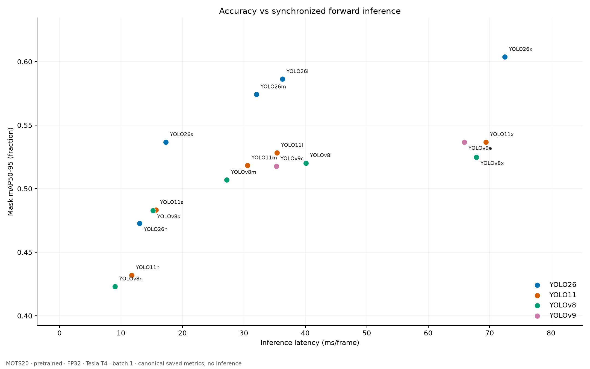
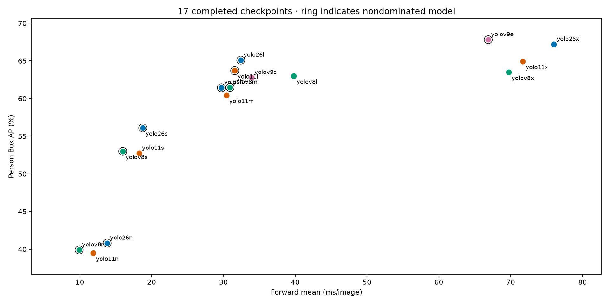

# รายงานวิจัยและข้อค้นพบของ YOLO Instance Segmentation

## วัตถุประสงค์และขอบเขตหลักฐาน

เปรียบเทียบ pretrained checkpoint พร้อม configuration สำหรับตรวจจับบุคคลและคืน instance masks เพื่อส่งต่อ Human Parsing ใช้งานระดับภาพ/เฟรม โดยใช้ผล benchmark ที่ปิดแล้ว การจัด repo รอบนี้สร้างตารางจาก aggregate ที่บันทึกไว้และตรวจการแพ็ก source แยกจากผล inference เดิม

## รุ่นและชุดข้อมูล

Roster สองชุดตรงกัน 17 checkpoints ได้แก่ YOLO26 x/l/m/s/n, YOLO11 x/l/m/s/n, YOLOv8 x/l/m/s/n และ YOLOv9 e/c ชื่อ tier เป็นกลุ่มขนาดเปรียบเทียบ parameters ของแต่ละ family ยังคงต่างกัน

| เงื่อนไข | MOTS20 | CCTV600 |
|---|---|---|
| Population | 2,862 เฟรม / 4 train sequences | 600 ภาพ |
| GT ที่ใช้ | person masks 26,894 instances รายเฟรม | visible person bbox 769 รายการ |
| งานหลัก | instance mask segmentation | person bbox detection จาก segmentation checkpoints |
| Preprocessing | square640, aspect-preserving letterbox, FP32, batch1 | square640, aspect-preserving letterbox, FP32, batch1 |
| Person / NMS | class0, confidence floor0.001, box NMS IoU0.7 | class0, confidence floor0.001, box NMS IoU0.7 |
| Matching ที่ operating point | confidence0.25 / mask IoU0.50 | confidence0.25 / bbox IoU0.50 |
| Ignore | MOTS class10 union; prediction-area IoA0.50 หลัง valid GT | ignore rectangles union และ bbox ต่ำกว่า50px; IoA0.50 หลัง valid GT |
| AP cap | 200 ตาม source config | 200 เทียบ reference1000 บน fixed100 ก่อน full quality |
| Model candidate cap | 1000 ตาม source baseline reference | 1000 พร้อม saturation guard |
| Timing | 3 clean rounds ×100 fixed frames | 3 accepted clean rounds ×100 fixed images |

CCTV600 มี source bboxes 774 รายการ คง bbox ต่ำกว่า50px อีก5รายการใน ignore eligibility ใช้ขนาด source visible bbox ก่อน clipping และ clip พิกัดเฉพาะ derived scoring Person inventory อิงการตรวจรับของเจ้าของ dataset ตามคู่มือ ≥50px สถานะความครบของ annotation และคนที่อยู่นอกเกณฑ์เป็นข้อจำกัดในการอ้างผลเต็มฉาก

MOTS20 รอบนี้ใช้ frame-level Mask AP ตาม protocol โครงงาน โดยอิง COCOeval และ ignore policy ของชุดข้อมูล จึงวัดขอบเขต person silhouette ได้ ส่วน CCTV600 detector GT ให้ bbox งานนี้จึงรายงาน native masks เป็น diagnostics และให้คะแนน bbox ตามคำตอบที่มี ข้อมูล train ของ benchmark ใช้เพื่อประเมิน pretrained models ตาม protocol ที่ประกาศ ไม่มีการปรับ weights ใน benchmark เหล่านี้

## นิยามและวิธีอ่าน metrics

- AP50–95 เฉลี่ย AP ที่ IoU0.50 ถึง0.95 ทีละ0.05 และ COCO101 recall points โดย confidence-ranked predictions; AP50/AP75 เป็น threshold เดียว
- Precision = TP/(TP+FP), Recall = TP/(TP+FN), F1 = 2TP/(2TP+FP+FN) ที่ confidence0.25/IoU0.50 จับคู่คนหนึ่งต่อหนึ่งตามลำดับ confidence และให้ valid GT มีสิทธิ์ก่อน ignore
- TP-only IoU และ Dice เฉลี่ยเฉพาะคู่ที่ match สำเร็จ อ่านควบคู่กับ Recall เพื่อเห็นบุคคลที่พลาด
- Forward ms/ภาพ วัดช่วงเรียกโมเดล synchronized ส่วน pipeline/adapter รวม pre/postprocessing และการคืน masks ตาม source boundaries; FPS =1000/mean ms ค่าเวลาของสองระบบมี scope รายละเอียดอยู่ใน TIMING_MASTER
- VRAM เป็น peak allocated MiB ระหว่างช่วงที่วัด parameters เป็น unfused checkpoint count และ GFLOPs เป็น estimate ตาม source method
- Aggregate precision/recall/F1 คิดจากผลรวม TP/FP/FN ส่วน pooled AP มาจาก confidence ranking ทั้ง population การเฉลี่ย AP ของแต่ละ sequence ให้ผลคนละนิยาม

## MOTS20 — ผล 17 checkpoints

| Model | Mask AP % | AP50 % | AP75 % | P % | R % | F1 % | Forward ms | Pipeline ms | VRAM MiB |
|---|---:|---:|---:|---:|---:|---:|---:|---:|---:|
| YOLO26x-Seg | 60.373 | 90.369 | 66.443 | 94.601 | 84.629 | 89.337 | 72.458 | 109.639 | 952.184 |
| YOLO11x-Seg | 53.667 | 87.581 | 57.584 | 93.870 | 82.223 | 87.661 | 69.406 | 105.885 | 942.478 |
| YOLOv9e-Seg | 53.664 | 88.204 | 57.210 | 93.423 | 82.658 | 87.711 | 65.888 | 103.376 | 855.407 |
| YOLOv8x-Seg | 52.476 | 86.640 | 56.045 | 92.160 | 81.427 | 86.462 | 67.843 | 109.441 | 1001.133 |
| YOLO26l-Seg | 58.624 | 88.989 | 64.354 | 93.570 | 83.439 | 88.214 | 36.266 | 76.403 | 777.520 |
| YOLO11l-Seg | 52.823 | 86.713 | 56.573 | 93.160 | 80.977 | 86.642 | 35.387 | 76.810 | 794.473 |
| YOLOv9c-Seg | 51.765 | 85.541 | 55.918 | 91.878 | 80.293 | 85.696 | 35.293 | 76.921 | 838.485 |
| YOLOv8l-Seg | 52.014 | 85.998 | 55.815 | 90.943 | 80.940 | 85.650 | 40.090 | 83.558 | 855.274 |
| YOLO26m-Seg | 57.422 | 87.352 | 62.904 | 91.833 | 81.531 | 86.376 | 32.043 | 77.309 | 912.162 |
| YOLO11m-Seg | 51.831 | 85.524 | 55.721 | 91.435 | 80.505 | 85.623 | 30.574 | 76.971 | 889.385 |
| YOLOv8m-Seg | 50.697 | 84.373 | 54.213 | 89.540 | 79.386 | 84.158 | 27.232 | 78.112 | 1018.762 |
| YOLO26s-Seg | 53.664 | 83.798 | 58.680 | 89.084 | 78.958 | 83.716 | 17.308 | 78.828 | 872.672 |
| YOLO11s-Seg | 48.327 | 81.743 | 51.382 | 86.827 | 76.415 | 81.289 | 15.693 | 88.836 | 1007.496 |
| YOLOv8s-Seg | 48.276 | 81.702 | 50.641 | 86.702 | 76.731 | 81.412 | 15.220 | 92.173 | 1139.010 |
| YOLO26n-Seg | 47.270 | 77.437 | 50.677 | 90.185 | 68.707 | 77.994 | 13.042 | 82.390 | 1043.133 |
| YOLO11n-Seg | 43.193 | 75.773 | 45.083 | 86.657 | 69.380 | 77.062 | 11.745 | 97.441 | 1030.000 |
| YOLOv8n-Seg | 42.306 | 75.002 | 43.912 | 82.641 | 69.692 | 75.616 | 9.045 | 95.683 | 1117.085 |

[CSV ก่อนปัดเศษ](../results/mots20/MASTER_17_MODELS.csv) · [68 per-sequence rows](../results/mots20/PER_SEQUENCE_MASTER.csv) · [Timing stages](../results/mots20/TIMING_MASTER.csv)

## CCTV600 — ผล 17 checkpoints

| Model | Box AP % | AP50 % | AP75 % | P % | R % | F1 % | Forward ms | Adapter ms | VRAM MiB |
|---|---:|---:|---:|---:|---:|---:|---:|---:|---:|
| yolo26x-seg.pt | 67.201 | 86.080 | 76.046 | 84.668 | 81.144 | 82.869 | 76.028 | 99.223 | 702.673 |
| yolo11x-seg.pt | 64.917 | 84.329 | 73.520 | 86.706 | 76.333 | 81.189 | 71.704 | 98.090 | 737.890 |
| yolov9e-seg.pt | 67.808 | 87.168 | 77.973 | 92.030 | 79.584 | 85.356 | 66.884 | 87.289 | 737.590 |
| yolov8x-seg.pt | 63.481 | 83.016 | 72.864 | 82.030 | 77.763 | 79.840 | 69.740 | 98.263 | 791.839 |
| yolo26l-seg.pt | 65.099 | 83.971 | 74.179 | 83.541 | 78.544 | 80.965 | 32.419 | 59.770 | 671.182 |
| yolo11l-seg.pt | 63.696 | 84.760 | 72.222 | 88.710 | 78.674 | 83.391 | 31.570 | 58.082 | 727.638 |
| yolov9c-seg.pt | 62.788 | 84.033 | 71.876 | 85.947 | 75.553 | 80.415 | 33.930 | 60.060 | 506.215 |
| yolov8l-seg.pt | 62.978 | 82.235 | 72.434 | 81.044 | 76.723 | 78.824 | 39.798 | 72.958 | 686.878 |
| yolo26m-seg.pt | 61.437 | 81.107 | 69.662 | 85.224 | 74.252 | 79.361 | 29.719 | 56.126 | 605.934 |
| yolo11m-seg.pt | 60.436 | 80.994 | 67.273 | 87.832 | 73.212 | 79.858 | 30.418 | 61.257 | 696.762 |
| yolov8m-seg.pt | 61.489 | 82.569 | 69.790 | 84.919 | 75.423 | 79.890 | 30.927 | 69.127 | 766.317 |
| yolo26s-seg.pt | 56.099 | 76.079 | 64.778 | 82.099 | 69.181 | 75.088 | 18.766 | 63.711 | 781.328 |
| yolo11s-seg.pt | 52.740 | 74.202 | 59.316 | 83.415 | 66.710 | 74.133 | 18.279 | 62.138 | 676.367 |
| yolov8s-seg.pt | 52.991 | 74.809 | 59.256 | 78.496 | 67.880 | 72.803 | 15.972 | 68.290 | 1094.403 |
| yolo26n-seg.pt | 40.817 | 61.914 | 45.176 | 77.822 | 51.105 | 61.695 | 13.818 | 69.345 | 1344.222 |
| yolo11n-seg.pt | 39.493 | 59.325 | 44.019 | 77.339 | 48.375 | 59.520 | 11.861 | 63.587 | 804.799 |
| yolov8n-seg.pt | 39.903 | 61.634 | 44.693 | 78.835 | 52.796 | 63.240 | 9.923 | 79.317 | 1154.993 |

[CSV ก่อนปัดเศษ](../results/cctv600/MASTER_17_MODELS.csv) · [Day/night และขนาดคน](../results/cctv600/PER_GROUP_RESULTS.csv) · [Timing stages](../results/cctv600/TIMING_MASTER.csv)

## การเลือกและข้อแลกเปลี่ยน

YOLO26x มี Mask AP สูงสุดบน MOTS20 โดย checkpoint ที่เลือกมี parameters 70,693,800 และขนาดไฟล์ 142,129,861 bytes ตรงกับโมเดลที่เว็บโหลดจริง ผู้ใช้ freeze selection นี้มาก่อนงานจัดส่งมอบ

บน CCTV600 YOLOv9e ได้ Box AP สูงกว่า YOLO26x 0.607 จุดเปอร์เซ็นต์ และ FP ต่ำกว่า ขณะที่ YOLO26x ได้ TP เพิ่ม 12 คนและ FN ลดลงเท่ากัน จึงต้องอ่าน AP, Recall และ false positives ร่วมกันตามงานปลายทาง

## Research insights

ขนาดที่เพิ่มขึ้นให้ประโยชน์ด้านความแม่นยำต่างกันตาม family บน MOTS20 YOLO26x เทียบ l เพิ่ม Mask AP 1.749 จุดเปอร์เซ็นต์ แต่ forward ใช้เวลา 72.458 เทียบ 36.266 ms/ภาพ ผลที่คนปลายทางได้รับจึงขึ้นกับทั้งการเก็บคนและงบเวลา

CCTV600 แสดงว่า forward ที่ลดลงตามขนาดอาจมาพร้อม adapter/VRAM ที่เพิ่มจาก native-mask postprocessing และ retained outputs ได้ ข้อมูลนี้ชี้ให้ตรวจ stage composition การยืนยันสาเหตุเชิงกลไกต้องใช้การทดลองที่ควบคุมเพิ่ม

Pareto แสดงตัวเลือกที่ไม่มีโมเดลอื่นดีกว่าหรือเท่ากันทุกแกนพร้อมดีกว่าอย่างน้อยหนึ่งแกน ค่า latency/VRAM frontier และ near-tie เป็น descriptive analyses จาก source tables ที่เก็บไว้ เกณฑ์ near-tie 0.001 ในหน่วย AP fraction เท่ากับ0.1จุดเปอร์เซ็นต์ ค่าใกล้กันยังต้องอ่านความต่างตาม sequence/กลุ่มและภาพประกอบ

ผล day/night ของ CCTV600 เป็น subgroup association ซึ่งองค์ประกอบภาพและขนาดคนต่างกัน การที่กลุ่ม night มี AP สูงกว่าในบางโมเดลยังใช้สรุปเหตุของแสงเพียงอย่างเดียวไม่ได้ ส่วน MOTS20 มี correlated video frames การเพิ่มจำนวนเฟรมใกล้กันเพิ่มความสัมพันธ์ของตัวอย่าง

การเปรียบเทียบเป็น checkpoint+configuration รวม architecture, weights/pretraining และ runtime adapter สถานะ source PASS_WITH_WARNINGS ของ MOTS20 ยังอยู่ โดยเฉพาะ correlated frames, timing sessions และ qualitative cases ที่เลือกเพื่อวิเคราะห์ความต่าง ผลทั้งหมดเป็น descriptive comparison

## Runtime ของระบบปลายทาง

ค่าที่เว็บใช้คือ confidence0.25, max_det200, imgsz640, retina_masks=True, half=False และ native Ultralytics defaults สำหรับ rect/NMS/end2end ที่ไม่ได้ override ส่วน research detector ใช้ floor0.001, cap1000, rect=False และ explicit common NMS ผลเวลาของ research pipeline จึงต้องระบุ settings ก่อนนำไปตั้ง SLA ของแอป รายละเอียดอยู่ใน [integration contract](INTEGRATION_CONTRACT.md)

## Provenance

Source commits, file-level selection และ local-only source ที่เลือกอธิบายอยู่ใน [inventory](SOURCE_INVENTORY.md) ผลเดิมอ้าง canonical tables ส่วนค่า pp/ตัวเลขที่ปัดเพื่อแสดงเป็น derived analysis รอบจัดเอกสาร หลักฐาน tests ของแพ็กเกจอยู่ใน [quality gates](QUALITY_GATES.md)
